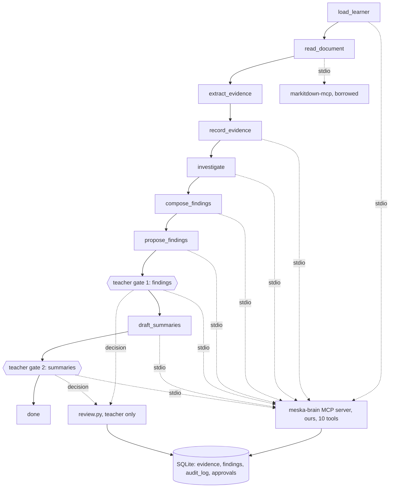

# Architecture

Meska Brain is two things on one SQLite file: an MCP server that holds the learner map and does the reasoning, and a LangGraph agent that uses that server to read a new document, investigate a learner and propose findings. A named teacher decides at two gates.

## Agent shape

The nodes run in the order shown, in `agent/workflow.py`. Each run is a LangGraph thread checkpointed to `data/checkpoints.db`. At a gate the node reads finding or summary status through the `get_findings` and `get_summaries` tools, so the check is in the audit log, and calls `interrupt` while anything is undecided. The run stops and `agent/runner.py` saves a record of the steps. The gate only passes when the database shows a teacher has decided every item, so resuming early just stops again. `meska resume` (or the web app, after a decision) continues the thread, even from a new process. The graph itself makes no database reads. The runner reads the database for one scheduling check (is anything at this gate still undecided) and finds open runs from its run record files; that is run scheduling, not an agent action.

Where it recovers or checks itself:

- **Conversion.** If markitdown fails and the file is `.txt`, `.md` or `.csv`, the agent reads it directly and logs that. Otherwise it records nothing from the file.
- **Wrong learner.** Before the model is called, code checks the document: if it names other learners and not the target, nothing is recorded. Rows whose quote names another learner are dropped.
- **Schema and failure.** The model copies marks and "out of" and the code does the division. Rows must match a schema; on a mismatch the model gets the error and tries again, up to three attempts. If the model call itself fails, reading ends with a log note and the run continues, so a model failure while reading does not fail the run.
- **Table rows.** If the document has a table of N rows and the model returned fewer, it is asked again (skipped when the document names other learners).
- **Missing term.** If the year or term is missing, one narrow follow-up question asks for it. As a last step the file name is used.
- **No source, no row.** A row whose quote is not found in the document is dropped.
- **Coverage.** After the model chooses its analysis tools (at most six calls), the agent checks that patterns, a trace for each struggle and what-worked were all run, and runs any that are missing. The agent sets `learner_id` on every model-chosen call and removes `min_periods`; the server also refuses `min_periods` below 3. So the model chooses which analysis to run, not the learner or the evidence bar.
- **Holes in the record.** If `trace_root` returns `root_is_certain: false` (an unrecorded prerequisite right under the root, from a grade the learner was enrolled in; confidence is capped at 0.35), the agent does not propose a finding. It adds an open question for the teacher. Prerequisites from before the learner's first recorded grade do not trigger this.
- **No repeated claims.** Candidate findings resting on mostly the same evidence are merged, keeping the more confident one, and are also compared with findings the teacher has already seen (approved or rejected).
- **Wording.** The model words each finding from structured facts. If `guard.py` rejects the text twice, a plain template is used. If the server refuses the model's wording at proposal time, the agent retries once with the template, which carries the "may begin even earlier" caveat.
- **Notes.** Drafts are one English guardian note (always), one guardian note in the home language when it is not English (a machine draft), and one English handover note. Each is checked by the guard, by a language check (`agent/language.py`: common words, or the script for Arabic and Amharic), and by a numbers check (no number that is not in the approved findings). If the home-language note fails after one retry it is not drafted and the step note says so. If an English note fails, the approved statements are used word for word.
- **Server refusals.** The server rejects findings with no or foreign evidence, summaries from unapproved findings, and text that fails the guard. The agent reports these refusals in its log.
- **Runs.** A learner can have one open run at a time; resume is claimed under a lock so two decisions cannot resume twice; after a gate the runner re-checks so a late decision cannot leave a run stuck; a run left "running" for 15 minutes by a dead process is marked failed.

## MCP servers: built and borrowed

Built: `server.py`, ten tools (seven read, three write) over `tools.py`. Every agent action on learner data goes through it, so each is written to `audit_log`. The two added read tools, `get_findings` and `get_summaries`, exist so the agent can see a teacher's decision without reading the database. Borrowed: Microsoft's `markitdown-mcp`, which turns PDFs, Office files, images and HTML into text. Document conversion is a large, solved problem, and a worse copy of it is not our contribution. Both servers are reached with the official `mcp` SDK client over stdio.

## Division of labour

- **The model** reads documents (in any language it can), chooses which analysis tools to call, and words short text.
- **The graph** does the reasoning: patterns held over terms, walking prerequisites back to a root, comparing a learner's scores before and after a teaching unit. It is deterministic and every result names its evidence rows.
- **The teacher** approves, edits or rejects. The agent has no tool that can approve; `review.py` is not exposed over MCP, and it writes the decision, the `approvals` row and the audit row in one transaction.
- **Evidence ids never come from the model.** They are copied from tool results.

## Data model

One SQLite file (`schema.sql`): `learners` (alias only), `teachers`, `teaching_units` (what was taught, when, which approach), `evidence` (quiz items, notes, attendance, each with a source), `findings` and `summaries` (proposals with a status), `approvals` (the named teacher), and `audit_log` (every tool call). The curriculum is not in the database: it is a pack file (`packs/<id>/pack.yaml`) loaded into a networkx directed graph, with an edge from each prerequisite to the concept that needs it. Skills in a pack can be marked as dispositions, which are never reported as struggles.

## Why SQLite and networkx

The target is a stranger running one command. SQLite is a file and networkx is a library, so there is nothing to install or start. The traversals are shallow (a curriculum of tens of concepts, walks a few steps deep), so a graph database would add setup without making any query faster.

## Why thinking mode is off

Small local models spend most of their time in "thinking" mode. The tasks here are narrow, and on `qwen3.5-9b` we measured about 70 seconds per call with thinking and under one second without. It is off by default (`MESKA_LLM_REASONING`).

## What would change for a real school

Real sign-in for teachers and an authenticated MCP endpoint; an import path for learners, teachers and teaching units; audit of page views as well as tool calls; more packs (other subjects, a school's own curriculum) and reviewed phrases and guard lists in local languages; a hosted or school-server deployment with backups; consent and data-protection arrangements before any real child's record is stored; a step that records a conversation with a family; and, first of all, trying it with a real teacher and changing what that teacher says is wrong.
